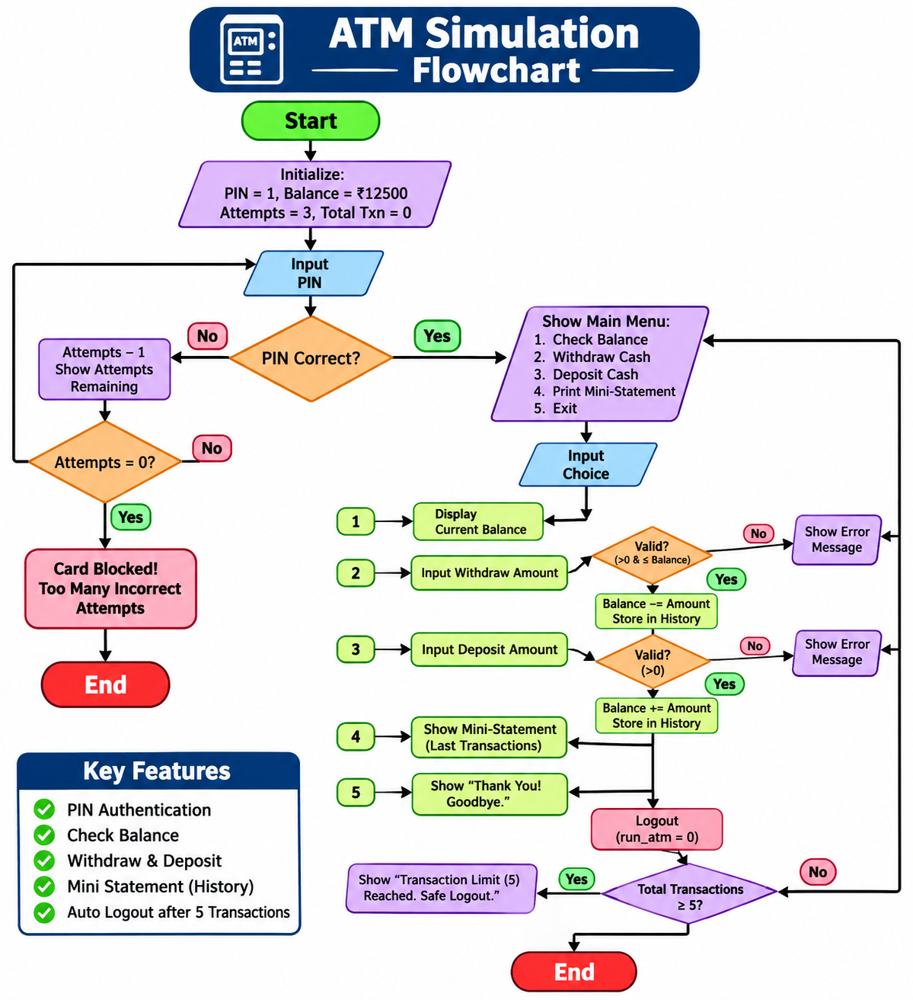

# ATM Simulation in C

A console-based ATM simulation project written in the C programming language. It demonstrates fundamental C concepts through a simple banking menu.

## Features

- PIN-based authentication (default PIN: `1`)
- Three attempts to enter the correct PIN
- Check the current account balance
- Deposit cash
- Withdraw cash with insufficient-funds validation
- Mini statement showing successful deposits and withdrawals
- Automatic logout after five successful transactions
- Session starts with a sample balance of INR 12,500.00

## Project structure

```text
ATM_Simulation/
├── src/
│   └── atm.c
├── docs/
│   └── PROJECT_NOTES.md
├── .gitignore
├── LICENSE
├── Makefile
└── README.md
```

## Requirements

- A C compiler such as GCC or Clang
- Windows, Linux, or macOS terminal

## Compile and run

### Linux / macOS

```bash
gcc -std=c11 -Wall -Wextra -pedantic src/atm.c -o atm
./atm
```

Or, if `make` is installed:

```bash
make
make run
```

### Windows (MinGW GCC)

Open Command Prompt or PowerShell in the project folder:

```bash
gcc -std=c11 -Wall -Wextra -pedantic src/atm.c -o atm.exe
.tm.exe
```

## How to use

1. Compile and start the program.
2. Enter the default PIN: `1`.
3. Select an option from the ATM menu:
   - `1` — Check balance
   - `2` — Withdraw cash
   - `3` — Deposit cash
   - `4` — Print mini statement
   - `5` — Exit
4. The session automatically ends after five successful deposits/withdrawals.

   ## Project Visuals

### 1. ATM Simulation Flowchart

The flowchart represents the complete working logic of the ATM system.



### 2. Project Screenshot

The screenshot shows the ATM Simulation project uploaded to GitHub.


**Note:** Balance enquiries and mini-statement views do not count toward the five-transaction limit. The balance and transaction history are stored in memory and reset when the program is restarted. This is an educational simulation, not a real banking application.

## C concepts demonstrated

- Basic data types: `int` and `float`
- Variables, constants, and local scope
- Arithmetic, relational, and logical operators
- `if-else` conditional statements
- `switch-case` menu selection
- `while` and `for` loops
- One-dimensional arrays
- Formatted input/output using `scanf()` and `printf()`
- Functions from the standard input/output and utility libraries

## GitHub upload

Create a new empty repository on GitHub. Then run these commands from this project folder:

```bash
git init
git add .
git commit -m "Add C ATM simulation project"
git branch -M main
git remote add origin https://github.com/YOUR-USERNAME/YOUR-REPOSITORY.git
git push -u origin main
```

Replace the remote URL with your own GitHub repository URL.
